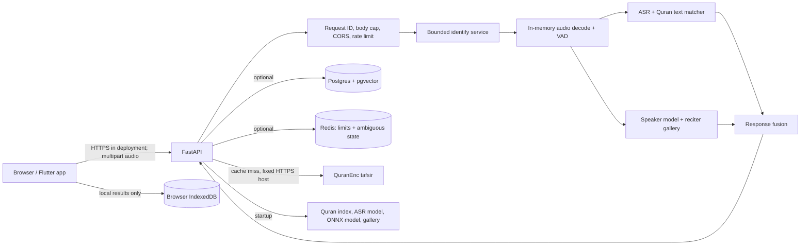

# ANSIT architecture audit

Audit date: 2026-11-22. Scope: repository source and local configuration, not a deployed environment.

## Current system

## Findings

- Web: Next.js App Router, React, TypeScript; Flutter client also exists.
- API: FastAPI app factory; versioned `/v1` routes and separate liveness/readiness endpoints.
- Audio: bounded multipart request, in-memory decode, duration cap, and no audio/transcript columns in event storage.
- Inference: index and models load once at startup; ASR and speaker branches run in a bounded thread pool behind an async semaphore. This is a single-process inference design.
- Storage: Postgres/pgvector is optional for event and gallery storage; file artifacts are the local fallback. Redis is optional for shared limits and ambiguous-result state.
- External dependency: tafsir is fetched lazily from one fixed QuranEnc HTTPS API host with an 8-second timeout and a process-local 6-hour cache.
- No separate job queue or object store is present. Inference remains synchronous from the caller's perspective, with bounded concurrency and queue timeout.

## Risks and scaling boundary

- Without Redis, limits and ambiguous state are process-local. The Redis rate-limit fallback now remains bounded locally but does not coordinate replicas.
- The model service is CPU-bound and each instance has a fixed inference pool. Historical load results show queueing beyond two concurrent users on a 4-vCPU host.
- A failed optional Postgres/Redis dependency degrades persistence or shared state; readiness reports configured dependency health. Redis failure degrades global rate enforcement and “listen longer” state.
- Gallery and Quran index are startup artifacts; a missing/corrupt artifact prevents readiness rather than serving partial matching.

No wholesale architecture rewrite is recommended. Scale by measuring an instance first, then add instances with healthy Redis/Postgres and a controlled artifact release process.
